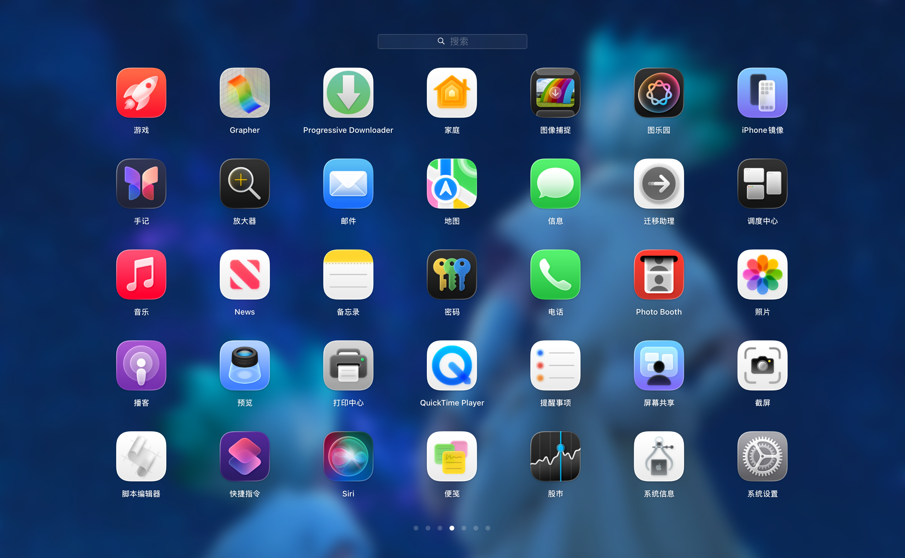

# Launcheer

**简体中文** | [English](README.md)

Launcheer 为 Mac 带回熟悉的启动台体验：全屏应用网格、文件夹、触控板翻页和快速应用搜索。你可以用鼠标、键盘，或 macOS 已识别的手柄选择并启动应用。

**需要 macOS 26.0 或以上版本、Apple Silicon。** 支持的系统版本共用同一个安装包，启动时检查本机原生组件是否兼容。

*Launcheer 应用网格。*

## 功能一览

| 功能 | 可以做什么 |
| --- | --- |
| 应用启动台 | 分页浏览应用，点击即可启动 |
| 文件夹与布局 | 拖动排序、创建文件夹、移入或移出应用，或右键平铺文件夹，布局保存在本机 |
| 智能整理 | 三种内置模式独立保存，也可把手动编排另存为命名分类 |
| 应用搜索 | 在启动台内搜索，或启用独立的全局搜索框；快捷搜索支持名称、拼音与首字母匹配 |
| 键盘与手柄 | 移动选择、确认启动、逐层返回，无需鼠标 |
| 背景 | 跟随当前桌面壁纸或选择自定义图片，保留半透明效果 |
| 外观 | 雾化淡入淡出、关闭过渡动画，以及更换 Launcheer 的 Dock 图标 |

## 快速开始

请使用 **Apple Silicon DMG 安装包**。打开 DMG，双击 **`Install Launcheer.pkg`**，按照 macOS 安装器的提示确认并授权。

安装器会要求退出正在运行的 Launcheer，将应用安装到当前系统盘的 `/Applications`；布局和偏好会保留。无需终端命令，也不要求重启。

PKG 未签名，内含 ad-hoc 签名的 App，未经过 Apple 公证。首次下载仍可能需要系统明确允许，安装器不绕过 macOS 安全检查。

1. 从“应用程序”打开 `Launcheer.app`。
2. 按 **Option + 空格**显示或收起启动台。
3. 点击应用启动，或在搜索框输入应用名称。
4. 在启动台搜索框输入 **`/settings`**打开设置，也可从 Launcheer 的应用菜单或 Dock 菜单选择**设置…**。

首次扫描后先显示应用名称与占位图标，再逐个补齐图标。点击空白处会收起启动台，应用继续运行，方便下次通过快捷键唤出。

### 常用操作

| 操作 | 效果 |
| --- | --- |
| Option + 空格 | 显示或收起启动台 |
| 触控板横向滑动 | 切换页面 |
| 方向键 / 回车 | 选择 / 打开应用或文件夹 |
| Esc | 逐层返回，再收起启动台 |
| 拖动图标 | 调整顺序，移入或移出文件夹 |
| 右键应用 | 在 Finder 中显示 |
| 右键文件夹 → 平铺 | 在当前位置展开应用，放不下时顺延到后续页 |
| 手柄十字键或左摇杆 / A / B | 选择 / 确认 / 返回 |
| 在启动台搜索框输入 `/version` | 查看当前运行版本与构建号 |
| 在启动台搜索框输入 `/智能整理` 或 `/autobuild` | 执行设置中保存的整理规则 |

主页面最后一个应用再次向右，会切换到下一页并选中首项。文件夹内的方向导航停留在当前网格，按 **B** 返回上一级。

## 设置

- **背景：**选择图片，或点击**跟随桌面**，修改后立即生效。**透明背景**默认开启，允许透出后方应用窗口；关闭后完全遮住。系统开启**降低透明度**时，背景保持不透明。如果 macOS 限制读取当前壁纸，可从应用菜单或 Dock 菜单选择**允许读取当前壁纸…**，手动选中该图片。
- **过渡动画：**勾选**关闭过渡动画**，显示与隐藏会立即完成。
- **应用图标：**选择或恢复 Launcheer 的 Dock 图标。仅改变运行时的 Dock 外观，不修改 Finder 中的应用图标。
- **全局应用搜索：**启用后按 **Option + Shift + 空格**唤出，也可在设置中录制自定义快捷键，组合需包含 Command、Option 或 Control。使用 ↑ / ↓ 选择，回车启动，Esc 收起。

全局应用搜索默认关闭，仅搜索应用。若希望使用 Command + 空格，请先在 macOS 的 Spotlight 设置中释放该快捷键。

在**设置 → 智能整理**中选择模式，保存后输入整理命令，或点击**立即应用**：

- **不分类（默认）：**展开全部文件夹，保持应用先后顺序，每页最多 35 项依次平铺。
- **智能分类：**参考系统分类，将应用放入开发工具、效率与财务、商业、社交、工具、娱乐、信息与阅读、创意、教育、其他文件夹。可按 App 类型和名称包含条件编辑规则，优先匹配靠前的规则；未匹配的应用保留原有顺序。
- **二分类：**系统内置应用排在前面，其他应用另起页，各类内部保留原先顺序，不创建分类文件夹。每页最多 35 项，单类超过一屏时会续页。

三种模式的布局分别保存，互不覆盖；保存设置不会切换布局，执行命令或立即应用后才切换。智能分类会收拢主页面多余分页，文件夹内部的分页保持不变。分类依据应用声明的公开类型，不复用 Apple 的私有推荐算法；未声明类型的应用归为“其他”。整理只在主动执行时运行。

调整好图标、分组和分页后，点击**另存为新分类…**并输入名称，保存当前正在使用的完整布局。保存不会覆盖已有方案，也不会自动切换；从模式列表选择**已保存：名称**，再点击**立即应用**即可使用。命名分类保留手动编排，输入整理命令也不会重新分类；后续手动调整保存在该命名分类中。重新保存快照请使用不同名称。

## 常见问题

### 会替换系统 Dock，或需要关闭 SIP 吗？

不会。Launcheer 是独立应用。主页面保留 Dock，打开文件夹时暂时隐藏，关闭文件夹后恢复。

### 支持所有 Mac 和 macOS 版本吗？

Launcheer 面向 **macOS 26.0 及以上的 Apple Silicon Mac**，不同系统版本共用同一个安装包。启动时检查并初始化本机原生组件，不再要求与构建机的 Dock 版本一致。同一份 GitHub 构建产物已在 **macOS 26.2 与 26.6.2** 通过无界面原生组件兼容检查；这不代表所有系统版本或完整界面交互均已验证。不支持 Intel。系统缺少所需组件时，会明确提示不兼容。

### 背景为什么与桌面不同？

启动台使用静态壁纸图片，并叠加透明与模糊效果，不播放动态壁纸。图片无法读取时仍可使用启动台，也可以在设置中另选可读取的图片。

### 布局保存在哪里？

布局与所选图片保存在本机 `~/Library/Application Support/Launcheer/`，正常升级会保留当前布局。不导入旧版 Launcheer 的布局格式或 Apple 启动台布局。

## 许可证

Launcheer 的自有代码采用 [MIT 许可证](LICENSE)。Copyright (c) 2026 ehehrun.

Apple 系统组件及资源保留其原有权利，不包含在本项目的 MIT 授权范围内。Launcheer 为独立项目，与 Apple 无关联。
